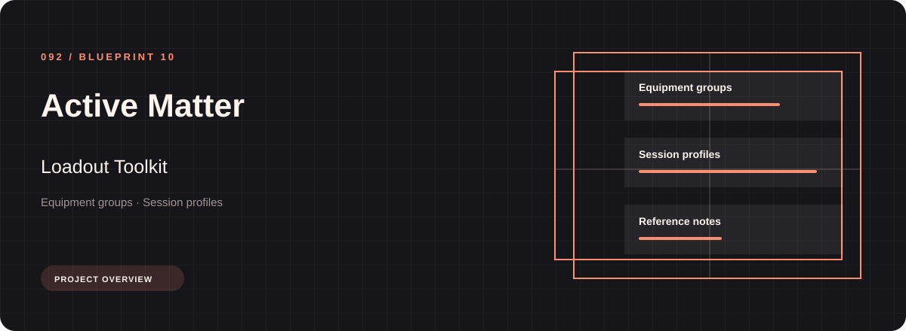
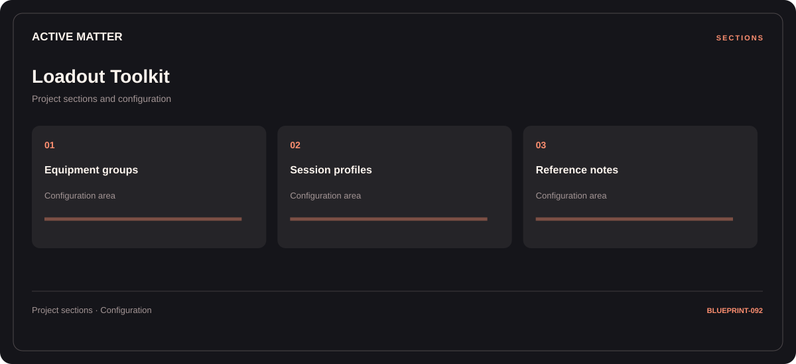

# 🛠️ Active Matter Loadout Toolkit

**Equipment groups · Session profiles · Reference notes**

## ⚡ Features

Use the Active Matter loadout toolkit workspace to move between equipment groups, session profiles, and reference notes. The section map below gives each part a clear place in the project.

### ⚙️ Equipment groups

Equipment categories and the associated selection or configuration options.

### 🧩 Session profiles

Related settings collected into named groups for a clearer configuration workflow.

### ⌨️ Reference notes

A dedicated section for reference notes and the configuration details associated with that area.

## 🖥️ Project navigation

## 📥 Download

The button and cover open the project's download page. Use the information supplied with the downloaded package for installation and release-specific requirements.

## 📚 Project documentation

- [Feature reference](docs/FEATURES.md)
- [Download information](docs/DOWNLOAD.md)
- [Project page](index.html)

---

Active Matter Loadout Toolkit · Program documentation and download information.
